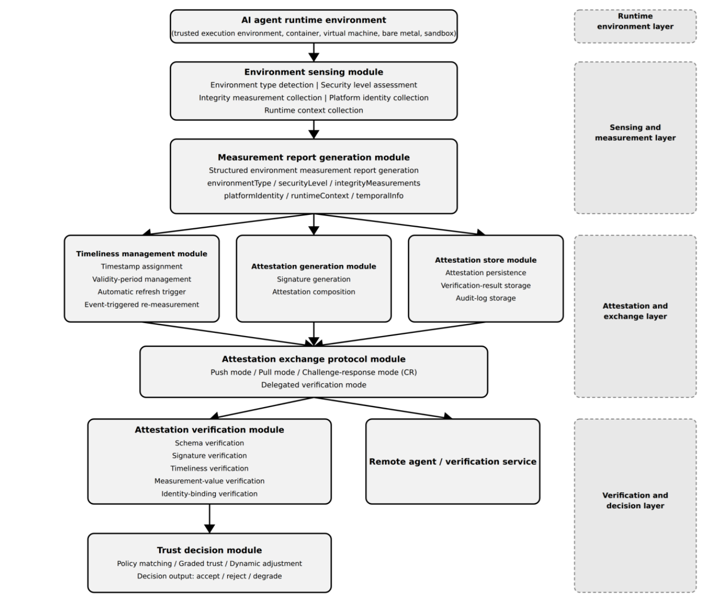

Overview of trusted environment measurement and attestation for AI agents
=========================================================================

Concept of trusted environment measurement and attestation for AI agents
------------------------------------------------------------------------

Trusted environment measurement and attestation for AI agents measures and cryptographically proves the security and trust properties of an AI agent's underlying execution environment. The service provides verifiable evidence of the integrity, isolation and operational state of the host platform. Relying parties (such as verifiers, orchestrators or peer agents) can then confirm that an AI agent runs in an authentic, secure and untampered environment before they delegate tasks, share sensitive model weights or grant access to protected resources.

AI agents increasingly run in heterogeneous, distributed and multi-tenant environments, such as cloud infrastructure, edge devices and on-premise servers.

This service relies on the following fundamental concepts:

- Trusted environment: an execution environment that uses logical or physical isolation, integrity protection and cryptographic evidence mechanisms to ensure an AI agent operates without unauthorized interference or observation by host processes or co-located workloads.

- Environment measurement process: collecting, calculating and aggregating cryptographic digests or state values that represent the hardware configuration, firmware, operating system components, container runtimes and execution parameters of the host platform.

- Environment attestation process: signing measurement evidence with a hardware-protected key bound to a Root of Trust, then presenting this evidence to an evaluating party to verify against predefined trust policies.

- Confidential computing: a security approach that protects data in use by performing calculations inside a hardware-isolated processing area.

- Execution environment: the hardware, operating systems, hypervisors and software libraries in which an AI agent runs.

- Trusted execution environment (TEE): a secure area within a processor that protects code and data from unauthorized access or modification during processing.

- Measurement report: a structured record that details the cryptographic integrity measurements, security levels and status of an execution platform.

- Attestation metadata: contextual information included in an attestation record, such as protocol versions, unique identifiers and challenge parameters.

- Validity period: the defined time window during which an environment measurement report remains current and trustworthy.

- Task sensitivity: a classification rating for a workload that uses data privacy and potential impact to set the required security level of the host environment.

- Trust decision: The final judgment that determines whether an AI agent can optionally execute a given task based on verified environment evidence.

The trusted environment measurement and attestation service has several key technical characteristics that establish a verifiable execution foundation for AI agents:

- Hardware-isolated execution: uses hardware-enforced boundaries (such as trusted execution environments, secure enclaves or dedicated security modules) to insulate measurement and attestation operations from host OS or hypervisor compromise.

- Integrity protection: provides cryptographically verifiable proof that software stacks, runtime configurations, model execution engines and policy definitions remain in a known, untampered state.

- Verifiable attestation: signs environment measurements digitally using key material managed by a hardware Root of Trust, ensuring evidence authenticity and non-repudiation.

- Freshness: includes nonces, timestamps or sequential counters in attestation protocols to prevent replay attacks using old, valid state measurements.

- Binding to agent identity: links environment attestation evidence cryptographically to the identity and operational credentials of the specific AI agent instance running inside that environment.

- Cross-platform interoperability: Standardized measurement representations and attestation data formats enable seamless verification across multi-cloud and edge deployment scenarios.

-Lifecycle management: Maintains measurement and attestation capabilities throughout all operational phases of the AI agent environment, including initialization, execution, dynamic update and shutdown.

Security framework of trusted environment measurement and attestation for AI agents
-----------------------------------------------------------------------------------

The framework for trusted environment measurement and attestation for AI agents defines functional components and their interrelationships, establishing the operational basis to measure platform state and evaluate evidence (Figure 1).

    Figure 1 – Security framework of trusted environment measurement and attestation for AI agents

As shown in Figure 1, the security framework comprises a set of functional modules arranged across four architectural layers:

- Environment sensing module: Collects raw attribute data of the agent execution environment from the runtime environment layer. It receives input from the execution environment itself (hardware, OS, TEE driver) and outputs a standardized document object containing environment type, security level, raw integrity measurement data, platform identity and runtime context.

- Measurement report generation module: Connects to the sensing module and converts raw attribute data into a structured environment measurement report ***M*** with all mandatory fields and optional extensions.

- Attestation generation module: Connects to the report generation module and signs ***M*** with the agent private key or a platform attestation key. It outputs the complete environment attestation ***A*** (report + signature + metadata).

- Attestation verification module: Receives ***A*** (locally generated or from a remote agent) and verifies its schema, signature, timeliness, measurement value and identity binding. It outputs result ***V*** (Verified / VerifiedWithWarnings / Failed) and verification details.

- Trust decision module: Connects to the verification module and evaluates ***V*** alongside the trust policy and task context to output decision ***D*** (accept/reject/degrade) with confidence level and constraints.

- Timeliness management module: Connects to the report generation and attestation generation modules. It assigns timestamps and validity periods, tracks remaining validity to trigger re-measurement before expiry, and uses environment-change events to trigger event-driven re-measurement.

- Attestation exchange protocol module: Connects to the generation and verification modules to implement four exchange modes: push (proactive send), pull (respond to requests), challenge-response (generate and verify nonce), and delegated verification (forward attestation and receive result).

- Attestation store module: Provides persistent storage for attestations, verification results, trust decisions and audit logs, supporting querying, trace-back and export for compliance auditing.

- Environment measurement data model: Serves as the standardized payload carrier across framework modules, defining uniform data structures for measurement records, attestation payloads and verification evidence.

These modules align with the security requirements in Clause 8 as follows.

These modules form four architectural layers:

- Runtime environment layer: The agent execution environment (TEE, container, virtual machine, bare metal, sandbox) that provides data for environment sensing.

- Sensing and measurement layer: Contains the environment sensing module and measurement report generation module.

- Attestation and exchange layer: Contains the timeliness management module, attestation generation module, attestation store module and attestation exchange protocol module.

- Verification and decision layer: Contains the attestation verification module and trust decision module.

The functional components interact as follows:

- The environment sensing module sends structured state measurements to the measurement report generation module, which creates report ***M*** for cryptographic encapsulation by the attestation generation module.

- The attestation generation module interacts with the attestation verification module through the attestation exchange protocol module using push, pull, challenge-response or delegated verification exchange patterns.

- The attestation verification module uses schema definitions from the environment measurement data model to parse, decode and evaluate the attestation from the attestation generation module, then sends the verification result to the trust decision module.

This framework directly supports the security risk analysis in Clause 7, establishes the structural baseline for security requirements in Clause 8, and guides the implementation methodologies in Clause 9.

The security framework comprises systems, functional entities and apparatuses that implement these core functional modules. The AI agent (attester) runs on an execution platform with a trusted execution environment or hardware security module holding the attestation key. Environment measurement and attestation functions run on the attester platform to capture state and generate cryptographically signed reports. The entity and any delegated verification service (verifier) receive and verify these reports. The attestation store records reports and verification results, while the governance and audit function monitors operations and enforces lifecycle compliance.

NOTE - In the following clauses, the attester denotes an AI agent that is the object of trusted environment measurement and attestation, and the verifier denotes an entity, including any relevant delegated verification service, that requests and verifies the measurement and attestation.

Implementers could build these entities, modules and functions in software, hardware or a combination of both across electronic devices, storage media and program products.
