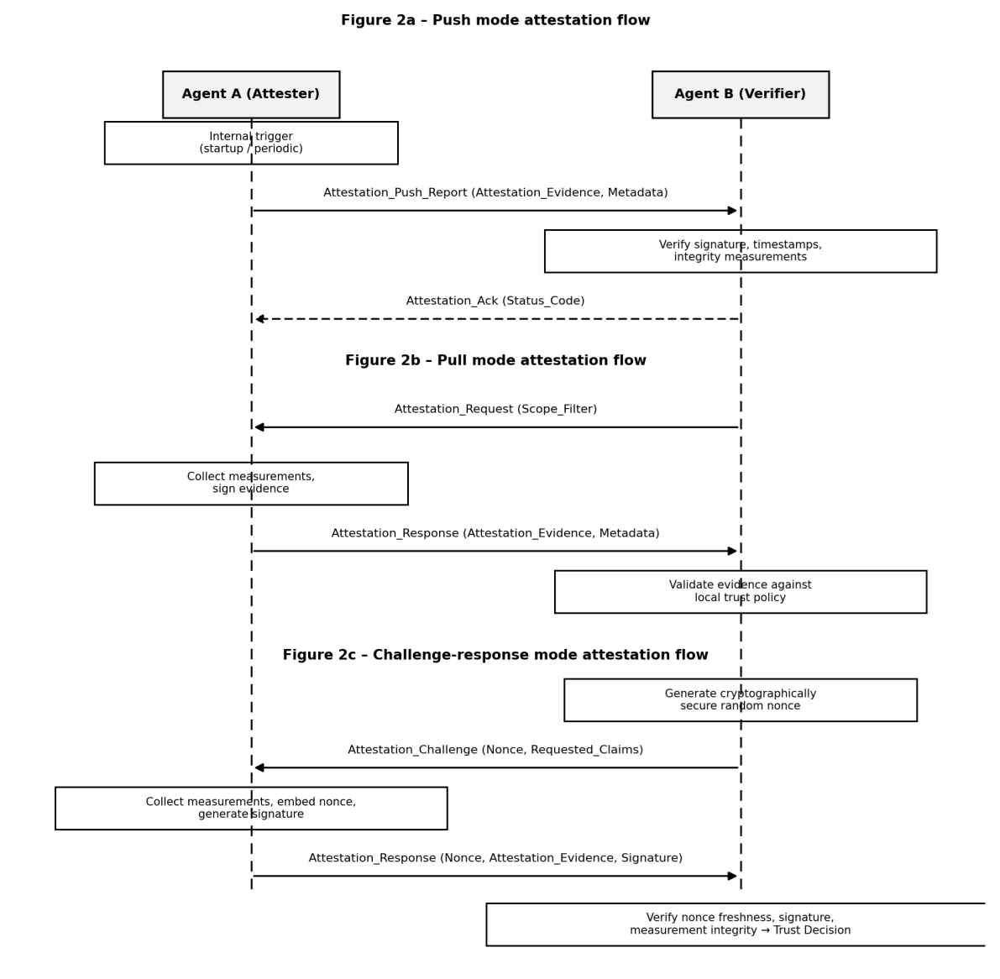

Environment measurement
-----------------------

The environment measurement procedure covers how environment evidence is collected and processed to ensure measurement authenticity and integrity. Clauses 9.2.1 to 9.2.6 specify the measurement dimensions, collection steps, encoding format, quality indicators, security considerations and data model.

Measurement dimensions
~~~~~~~~~~~~~~~~~~~~~~

The environment measurement methodology defines five measurement dimensions to capture the security state of the AI agent execution environment:

a) Environment type identification: Identifies the execution environment type, supporting values TEE (Intel SGX, AMD SEV, ARM TrustZone), container, virtualMachine, bareMetal, sandbox (WebAssembly, gVisor) and unknown when undetermined. Detection uses CPUID for SGX, SEV status for AMD SEV, TEE drivers for TrustZone, dockerenv or cgroup for containers, and DMI information or the CPUID hypervisor bit for virtual machines.

b) Security level classification: Quantifies the assurance level as hardwareIsolated (hardware-enforced isolation with provable integrity, e.g. TEE), softwareIsolated (container, sandbox, virtual machine), standard (standard OS protection only) or unknown when undetermined.

c) Integrity measurements: Captures measurements for each environment type: for TEE, native TEE measurements (SGX MRENCLAVE and MRSIGNER, AMD SEV measurement report, TrustZone measurements), BIOS/firmware version and measurements, and TPM platform configuration register (PCR) values; for container/sandbox, container image digest or hash, runtime configuration hash, kernel version and security module status; for virtual machine, VM image measurement, hypervisor version and security configuration, and guest OS integrity measurements; for bare metal, BIOS/firmware measurements, bootloader and kernel measurements (Measured Boot, IMA) and TPM PCR.

d) Platform identity: Identifies the underlying hardware platform by collecting the platform unique identifier (hardware unique ID when available), manufacturer and model, TEE technology and version, and firmware/BIOS version, linking the report to a physical or virtual platform.

e) Runtime context: Records operational parameters, agent identity (cryptographically bound to the measurement report), agent runtime version, OS name and version, and security module status (SELinux, AppArmor), linking the report to a specific agent instance and its task context.

Measurement collection
~~~~~~~~~~~~~~~~~~~~~~

The measurement module executes a secure collection procedure (steps A–F) to ensure data authenticity, establish a secure chain of trust and mitigate measurement tampering risks (RSK-01):

- Step A – Environment type detection: An environment sensing module detects the environment type.

- Step B – Security level assessment: A security-level sub-module classifies the level.

- Step C – Integrity measurement collection: An integrity sub-module calls the matching measurement interface (TEE native interfaces such as SGX EREPORT, SEV attestation report, TrustZone attestation; otherwise TPM quote / IMA list / software integrity check).

- Step D – Platform identity collection: A platform-identity sub-module reads platform identifiers.

- Step E – Runtime context collection: A runtime-context sub-module reads agent identity and runtime information.

- Step F – Measurement report generation: A measurement report generation module encodes all collected data into a structured report, records the measurement timestamp and validity period, and generates measurementId.

    Figure 2 – Main procedures for AI agent environment attestation

Measurement encoding format
~~~~~~~~~~~~~~~~~~~~~~~~~~~

The relevant systems serialize collected measurements using standardized, canonical encoding formats such as JSON or CBOR (JSON for human interaction and CBOR for efficient binary transport). In accordance with REQ-MM-05, the encoding format ensures that identical measurement data yields deterministic byte representations, preventing cryptographic signature verification failures. The normative schema defines mandatory data types, value constraints and structured namespaces for all attributes specified in Clause 8.1.

Measurement quality indicators
~~~~~~~~~~~~~~~~~~~~~~~~~~~~~~

To enable fine-grained trust evaluations by the verifier, systems augment environment measurements with the following quality and assurance indicators:

a) Measurement source: Indicates whether the measurement originated from a hardware TEE, a hypervisor or a software measurement agent.

b) Measurement confidence: Defines an assurance rating derived from the tamper-resistance level of the collection mechanism.

c) Measurement scope: Specifies the coverage of the measurement payload, such as full platform, container runtime or model weights only.

d) Measurement freshness: Captures the time elapsed since the measurement was collected.

e) Attestation capability: Declares supported cryptographic algorithms and signature schemes available for attestation generation.

Measurement security considerations and extensibility
~~~~~~~~~~~~~~~~~~~~~~~~~~~~~~~~~~~~~~~~~~~~~~~~~~~~~

To ensure the resilience of the measurement methodology:

a) Tamper resistance: The measurement collection logic executes within an isolated domain, such as a TEE or hardware security module, preventing modification by compromised guest operating systems or malicious AI agent components.

b) Secure collection channels: Inter-component measurement communication uses authenticated memory buffers or encrypted inter-process communication channels.

c) Extensibility: The measurement framework supports custom measurement profiles, including specialized AI accelerator or vector database metrics, via structured extension fields while maintaining compatibility with the baseline schema.

Measurement data model
~~~~~~~~~~~~~~~~~~~~~~

The structured measurement data model comprises a set of fields:

- schemaVersion (data-model version),

- measurementId (unique measurement report identifier),

- environmentType (TEE\|container\|virtualMachine\|bareMetal\|sandbox\|unknown),

- securityLevel (hardwareIsolated\|softwareIsolated\|standard\|unknown),

- teeTechnology (SGX\|SEV\|TrustZone; empty for non-TEE),

- teeVersion,

- integrityMeasurements (list; each item = measurementType, algorithm, value in hex or Base64),

- platformIdentity (platformId, manufacturer, model, firmwareVersion),

- runtimeContext (agentId, runtimeVersion, osName, osVersion),

- temporalInfo (measurementTime, notBefore, notAfter),

- attestationMechanism (TPM\|SGX\|SEV\|TrustZone\|software\|other) and

- extensions (environment-type-specific and platform-specific attributes, compliance data).
